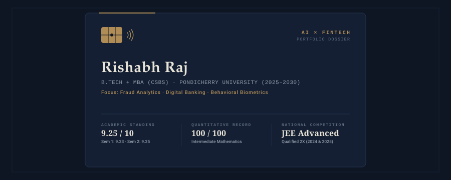
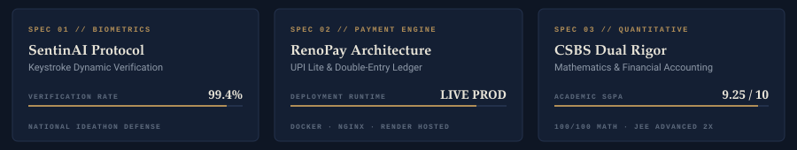
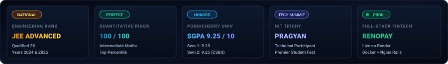
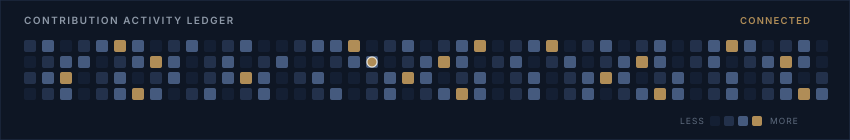

<div align="center">

<!-- HERO BANNER: Editorial FinTech Identity Card -->
<picture>
  <source media="(prefers-color-scheme: dark)" srcset="assets/hero-card-dark.svg">
  <source media="(prefers-color-scheme: light)" srcset="assets/hero-card-light.svg">
  
</picture>

<br/><br/>

<!-- ANIMATED TYPING TELEMETRY -->
<a href="https://github.com/rajrishabh23959-oss">
  
</a>

<br/><br/>

<!-- ACTION RAIL: EDITORIAL FLAT BADGES -->
<a href="https://rajrishabh23959-oss.github.io/rishabh_portfolio/"></a>
&nbsp;
<a href="https://linkedin.com/in/rishabh-raj-804755382"></a>
&nbsp;
<a href="mailto:rajrishabh23959@gmail.com"></a>
&nbsp;
<a href="https://github.com/rajrishabh23959-oss"></a>

<br/><br/>

<!-- EDITORIAL NAVIGATION -->
<code><a href="#executive-dossier">DOSSIER</a></code> &nbsp;·&nbsp;
<code><a href="#technical-telemetry">TELEMETRY</a></code> &nbsp;·&nbsp;
<code><a href="#selected-deployments">DEPLOYMENTS</a></code> &nbsp;·&nbsp;
<code><a href="#capabilities--technical-stack">CAPABILITIES</a></code> &nbsp;·&nbsp;
<code><a href="#academic--quantitative-benchmarks">BENCHMARKS</a></code> &nbsp;·&nbsp;
<code><a href="#activity--contribution-ledger">ACTIVITY</a></code> &nbsp;·&nbsp;
<code><a href="#contact--engagement">CONTACT</a></code>

<br/><br/>

<picture>
  <source media="(prefers-color-scheme: dark)" srcset="assets/divider-dark.svg">
  <source media="(prefers-color-scheme: light)" srcset="assets/divider-light.svg">
  
</picture>

</div>

## Executive Dossier

<table>
  <tr>
    <td width="60%" valign="top">
      <h3>Candidate Profile</h3>
      <p>I am an integrated <b>B.Tech + MBA candidate in Computer Science &amp; Business Systems at Pondicherry University (2025–2030)</b>. My engineering focus centers at the high-stakes intersection of <b>AI-driven fraud mitigation, digital banking architecture, behavioral biometrics, and intelligent ledgers</b>.</p>
      <p>By coupling rigorous mathematical foundations with institutional accounting principles, I build payment systems and security rails that are mathematically deterministic and production resilient.</p>
      <p><b>Primary Objective:</b> Actively seeking an <b>AI / FinTech Analyst Internship</b> to engineer high-throughput fraud analytics, quantitative models, and next-generation transaction infrastructure.</p>
    </td>
    <td width="40%" valign="top">
      <h3>Academic &amp; Operational Ledger</h3>
      <ul>
        <li><b>Institution:</b> Pondicherry University</li>
        <li><b>Discipline:</b> CSBS (Dual Engineering + MBA)</li>
        <li><b>Timeline:</b> 2025 – 2030</li>
        <li><b>Academic Index:</b> SGPA 9.23 (S1) · 9.25 (S2)</li>
        <li><b>Quantitative:</b> 100/100 Math · JEE Adv (2X)</li>
        <li><b>Core Focus:</b> AI Fraud Analytics &amp; UPI Rails</li>
        <li><b>Availability:</b> Open for Internship</li>
      </ul>
    </td>
  </tr>
</table>

<div align="center">
<picture>
  <source media="(prefers-color-scheme: dark)" srcset="assets/divider-dark.svg">
  <source media="(prefers-color-scheme: light)" srcset="assets/divider-light.svg">
  
</picture>
</div>

## Technical Telemetry

<div align="center">
<picture>
  <source media="(prefers-color-scheme: dark)" srcset="assets/fintech-metrics-dark.svg">
  <source media="(prefers-color-scheme: light)" srcset="assets/fintech-metrics-light.svg">
  
</picture>
</div>

<div align="center">
<picture>
  <source media="(prefers-color-scheme: dark)" srcset="assets/divider-dark.svg">
  <source media="(prefers-color-scheme: light)" srcset="assets/divider-light.svg">
  
</picture>
</div>

## Selected Deployments

<table>
  <tr>
    <td width="50%" valign="top">
      <h3>RenoPay</h3>
      <p><b>Next-Gen Full-Stack UPI Payments &amp; AI Bookkeeping Engine</b></p>
      <p>An enterprise-grade payments platform architected end-to-end. Features instant UPI transfers, low-friction <b>UPI Lite</b> offline rails, collaborative multi-user shared vaults, and automated bookkeeping powered by <b>formal double-entry ledger logic</b>.</p>
      <p>Integrated with the <b>SentinAI</b> fraud detection suite to intercept suspicious transfer velocity in real time.</p>
      <p><b>Production Infrastructure:</b> Containerized with Docker, reverse-proxied via Nginx, and deployed live on Render.</p>
      <p>
        
        
        
        
        
      </p>
    </td>
    <td width="50%" valign="top">
      <h3>SENTINAI</h3>
      <p><b>Keystroke-Dynamics Behavioral Biometrics for Banking Security</b></p>
      <p>An advanced biometric risk-scoring pipeline designed to solve account-takeover (ATO) and credential stuffing fraud. Employs <b>keystroke flight-time and dwell-time dynamics</b> to continuously verify user identity behind transaction authorizations.</p>
      <p>Operates entirely non-intrusively without relying on static SMS OTPs or passwords alone.</p>
      <p><b>Milestone:</b> Selected, pitched, and defended before an expert evaluation panel at a national-level Ideathon.</p>
      <p>
        
        
        
        
      </p>
    </td>
  </tr>
  <tr>
    <td width="50%" valign="top">
      <h3>InnovateX</h3>
      <p><b>AI-Powered Financial Modernization &amp; Banking Transformation</b></p>
      <p>A strategic modernization blueprint bridging legacy financial systems with autonomous intelligence. Synthesizes core financial accounting principles (<b>Journal &amp; Ledger double-entry reconciliation</b>) with predictive AI pipeline orchestration.</p>
      <p>Designed to accelerate audit velocity, prevent ledger drift, and bring real-time compliance transparency to core banking operations.</p>
      <p>
        
        
        
        
      </p>
    </td>
    <td width="50%" valign="top">
      <h3>Treasure Hunter</h3>
      <p><b>2D Arcade State Engine &amp; Real-Time Game Mechanics</b></p>
      <p>An interactive 2D arcade title written from scratch in Python and Pygame. Engineered with custom bounding-box collision detection algorithms, multi-layered asset rendering loops, and an immutable finite state manager handling game loop transitions.</p>
      <p>Served as a hands-on proving ground for low-latency state synchronization, deterministic logic, and real-time execution.</p>
      <p>
        
        
        
        
      </p>
    </td>
  </tr>
</table>

### Specialized Venture R&amp;D Portfolio

| Project | Domain | Architectural Hook |
| :--- | :--- | :--- |
| **NemEdico** | HealthTech Rails | Integrated digital healthcare ecosystem bridging patient records, clinic consults, and pharmacy supply chains. |
| **Habit Tracker** | Behavioral Analytics | Micro-habit tracking engine structured around streak persistence, behavioral cadence, and productivity loops. |
| **EklavyaX** | EdTech Intelligence | Interactive gamified learning architecture engineered for adaptive curriculum pacing and engagement analytics. |
| **MAHAN** | Talent Network | Socio-economic matching platform mobilizing retired and experienced industry professionals for advisory engagements. |

> 🔗 *Detailed project documentation, system diagrams, and live demos are accessible on my **[Interactive Portfolio](https://rajrishabh23959-oss.github.io/rishabh_portfolio/)**.*

<div align="center">
<picture>
  <source media="(prefers-color-scheme: dark)" srcset="assets/divider-dark.svg">
  <source media="(prefers-color-scheme: light)" srcset="assets/divider-light.svg">
  
</picture>
</div>

## Capabilities &amp; Technical Stack

```
┌────────────────────────────────────────────────────────────────────────────────────────┐
│  CAPABILITIES LEDGER // INTEGRATED CSBS TECHNICAL & BUSINESS CAPITAL STACK             │
└────────────────────────────────────────────────────────────────────────────────────────┘
```

#### AI, Quantitative Modeling &amp; Data Science
<p>
  
  
  
  
  
</p>

#### FinTech, Ledger Architecture &amp; Business Intelligence
<p>
  
  
  
  
  
  
</p>

#### Core Software Engineering &amp; Languages
<p>
  
  
  
  
  
  
  
</p>

#### Infrastructure, DevOps &amp; Development Toolchain
<p>
  
  
  
  
  
  
  
</p>

<div align="center">
<picture>
  <source media="(prefers-color-scheme: dark)" srcset="assets/divider-dark.svg">
  <source media="(prefers-color-scheme: light)" srcset="assets/divider-light.svg">
  
</picture>
</div>

## Academic &amp; Quantitative Benchmarks

<div align="center">
<picture>
  <source media="(prefers-color-scheme: dark)" srcset="assets/achievements-strip-dark.svg">
  <source media="(prefers-color-scheme: light)" srcset="assets/achievements-strip-light.svg">
  
</picture>
</div>

<br/>

<table>
  <tr>
    <td width="33%" align="center">
      <br/>
      <b>JEE ADVANCED</b>
      <br/><br/>
      <b>QUALIFIED 2X</b>
      <br/>
      <b>2024 &amp; 2025</b>
      <p style="font-size:12px;">Top-tier national percentile among India's competitive engineering aspirants.</p>
    </td>
    <td width="33%" align="center">
      <br/>
      <b>MATHEMATICS</b>
      <br/><br/>
      <b>100 / 100</b>
      <br/>
      <b>PERFECT RAW SCORE</b>
      <p style="font-size:12px;">Flawless performance in Intermediate Mathematics &amp; quantitative foundations.</p>
    </td>
    <td width="33%" align="center">
      <br/>
      <b>UNIVERSITY ACADEMICS</b>
      <br/><br/>
      <b>SGPA 9.23 &amp; 9.25</b>
      <br/>
      <b>SEMESTERS 1 &amp; 2</b>
      <p style="font-size:12px;">Consistent academic distinction in CSBS at Pondicherry University.</p>
    </td>
  </tr>
  <tr>
    <td width="33%" align="center">
      <br/>
      <b>SENTINAI PITCH</b>
      <br/><br/>
      <b>IDEATHON DEFENSE</b>
      <br/>
      <b>EXPERT EVALUATION</b>
      <p style="font-size:12px;">Presented keystroke behavioral biometrics framework to a judged panel.</p>
    </td>
    <td width="33%" align="center">
      <br/>
      <b>PRAGYAN TECH SUMMIT</b>
      <br/><br/>
      <b>NIT TRICHY</b>
      <br/>
      <b>ACTIVE PARTICIPANT</b>
      <p style="font-size:12px;">Engaged in premier technological competitions and workshops.</p>
    </td>
    <td width="33%" align="center">
      <br/>
      <b>NATIONAL LITERACY</b>
      <br/><br/>
      <b>GOVT OF INDIA</b>
      <br/>
      <b>DIGITAL &amp; FINANCIAL</b>
      <p style="font-size:12px;">Recognized across digital and financial literacy initiatives.</p>
    </td>
  </tr>
</table>

<div align="center">
<picture>
  <source media="(prefers-color-scheme: dark)" srcset="assets/divider-dark.svg">
  <source media="(prefers-color-scheme: light)" srcset="assets/divider-light.svg">
  
</picture>
</div>

## Current Research &amp; Engineering

<table>
  <tr>
    <td width="50%">
      <h4>Active Architecture</h4>
      <ul>
        <li><b>RenoPay Optimization:</b> Hardening UPI Lite offline fallback states &amp; stress-testing automated double-entry ledger balancing.</li>
        <li><b>SENTINAI Keystroke Calibration:</b> Enhancing timing anomaly detectors to reduce false-positive authentication rejects.</li>
      </ul>
    </td>
    <td width="50%">
      <h4>Knowledge Ingestion</h4>
      <ul>
        <li><b>Node.js:</b> Expanding backend event-driven architectures and concurrent I/O throughput.</li>
        <li><b>PyTorch &amp; Deep Learning:</b> Exploring non-linear neural networks for transactional behavioral anomaly detection.</li>
      </ul>
    </td>
  </tr>
</table>

<div align="center">
<picture>
  <source media="(prefers-color-scheme: dark)" srcset="assets/divider-dark.svg">
  <source media="(prefers-color-scheme: light)" srcset="assets/divider-light.svg">
  
</picture>
</div>

## Activity &amp; Contribution Ledger

<div align="center">


&nbsp;


<br/><br/>


<br/><br/>

<!-- SNAKE CONTRIBUTION ANIMATION -->
<picture>
  <source media="(prefers-color-scheme: dark)" srcset="https://raw.githubusercontent.com/rajrishabh23959-oss/rajrishabh23959-oss/output/github-contribution-grid-snake-dark.svg">
  <source media="(prefers-color-scheme: light)" srcset="https://raw.githubusercontent.com/rajrishabh23959-oss/rajrishabh23959-oss/output/github-contribution-grid-snake.svg">
  
</picture>

</div>

<div align="center">
<picture>
  <source media="(prefers-color-scheme: dark)" srcset="assets/divider-dark.svg">
  <source media="(prefers-color-scheme: light)" srcset="assets/divider-light.svg">
  
</picture>
</div>

## Working Principles

> **Computational Principle:** *"Double-entry bookkeeping and distributed systems share the exact same mathematical soul: every state mutation must balance across the ledger with zero tolerance for drift."*

> **Guiding Thesis:** *"Curious about systems. Excited by ideas that connect code with real-world impact."*

<div align="center">
<picture>
  <source media="(prefers-color-scheme: dark)" srcset="assets/divider-dark.svg">
  <source media="(prefers-color-scheme: light)" srcset="assets/divider-light.svg">
  
</picture>
</div>

## Contact &amp; Engagement

<div align="center">

<h3>Pipeline Status: Open for AI / FinTech Analyst Internships</h3>
<p>
If you are engineering next-generation transaction rails, quantitative risk models, behavioral security, or AI-driven banking infrastructure, let's connect.
</p>

<br/>

<a href="https://rajrishabh23959-oss.github.io/rishabh_portfolio/"></a>
&nbsp;&nbsp;
<a href="https://linkedin.com/in/rishabh-raj-804755382"></a>
&nbsp;&nbsp;
<a href="mailto:rajrishabh23959@gmail.com"></a>

<br/><br/>

<sub>© 2026 Rishabh Raj · B.Tech + MBA in Computer Science &amp; Business Systems · Pondicherry University</sub>

</div>
