<div align="center">

<!-- HERO BANNER: Futuristic Glass-Morphism FinTech Card -->
<picture>
  <source media="(prefers-color-scheme: dark)" srcset="assets/hero-card-dark.svg">
  <source media="(prefers-color-scheme: light)" srcset="assets/hero-card-light.svg">
  
</picture>

<br/><br/>

<!-- ANIMATED TYPING TELEMETRY -->
<a href="https://github.com/rajrishabh23959-oss">
  
</a>

<br/><br/>

<!-- ACTION RAIL: CLEAN VERIFIED BUTTONS -->
<a href="https://rajrishabh23959-oss.github.io/rishabh_portfolio/"></a>
<a href="https://linkedin.com/in/rishabh-raj-804755382"></a>
<a href="mailto:rajrishabh23959@gmail.com"></a>
<a href="https://github.com/rajrishabh23959-oss"></a>

<br/><br/>

<!-- TERMINAL QUICK-NAV -->
<code><a href="#-executive-summary">DOSSIER</a></code> &nbsp;·&nbsp;
<code><a href="#-system-telemetry">TELEMETRY</a></code> &nbsp;·&nbsp;
<code><a href="#-flagship-deployments">FLAGSHIP RAILS</a></code> &nbsp;·&nbsp;
<code><a href="#-capabilities-matrix">CAPABILITIES</a></code> &nbsp;·&nbsp;
<code><a href="#-quantitative-rigor--benchmarks">BENCHMARKS</a></code> &nbsp;·&nbsp;
<code><a href="#-analytics--activity-ledger">ACTIVITY</a></code> &nbsp;·&nbsp;
<code><a href="#-direct-inquiry--dispatch">CONNECT</a></code>

<br/><br/>

<picture>
  <source media="(prefers-color-scheme: dark)" srcset="assets/divider-dark.svg">
  <source media="(prefers-color-scheme: light)" srcset="assets/divider-light.svg">
  
</picture>

</div>

## 🏛 Executive Summary

<table>
  <tr>
    <td width="60%" valign="top">
      <h3>◈ PROFILE DOSSIER</h3>
      <p>I am an integrated <b>B.Tech + MBA candidate in Computer Science &amp; Business Systems at Pondicherry University (2025–2030)</b>. My engineering focus centers at the high-stakes intersection of <b>AI-driven fraud mitigation, digital banking architecture, behavioral biometrics, and intelligent ledgers</b>.</p>
      <p>By coupling rigorous mathematical foundations with institutional accounting principles, I build payment systems and security rails that are mathematically deterministic and production resilient.</p>
      <p>🎯 <b>Primary Objective:</b> Actively seeking an <b>AI / FinTech Analyst Internship</b> to engineer high-throughput fraud analytics, quantitative models, and next-generation transaction infrastructure.</p>
    </td>
    <td width="40%" valign="top">
      <h3>◈ LEDGER SNAPSHOT</h3>
      <ul>
        <li><b>Institution:</b> Pondicherry University</li>
        <li><b>Discipline:</b> CSBS (Dual Engineering + MBA)</li>
        <li><b>Timeline:</b> 2025 – 2030</li>
        <li><b>Academic Index:</b> SGPA 9.23 (S1) · 9.25 (S2)</li>
        <li><b>Quantitative:</b> 100/100 Math · JEE Adv (2X)</li>
        <li><b>Core Focus:</b> AI Fraud Analytics &amp; UPI Rails</li>
        <li><b>Deployment Status:</b> 🟢 Available for Internship</li>
      </ul>
    </td>
  </tr>
</table>

<div align="center">
<picture>
  <source media="(prefers-color-scheme: dark)" srcset="assets/divider-dark.svg">
  <source media="(prefers-color-scheme: light)" srcset="assets/divider-light.svg">
  
</picture>
</div>

## ⚡ System Telemetry

<!-- Animated FinTech Metrics & Telemetry Card -->
<div align="center">
<picture>
  <source media="(prefers-color-scheme: dark)" srcset="assets/fintech-metrics-dark.svg">
  <source media="(prefers-color-scheme: light)" srcset="assets/fintech-metrics-light.svg">
  
</picture>
</div>

<div align="center">
<picture>
  <source media="(prefers-color-scheme: dark)" srcset="assets/divider-dark.svg">
  <source media="(prefers-color-scheme: light)" srcset="assets/divider-light.svg">
  
</picture>
</div>

## 💳 Flagship Deployments

<!-- 2x2 Grid of Designed Project Cards -->
<table>
  <tr>
    <td width="50%" valign="top">
      <h3>💳 RenoPay</h3>
      <p><b>Next-Gen Full-Stack UPI Payments &amp; AI Bookkeeping Engine</b></p>
      <p>An enterprise-grade payments platform architected end-to-end. Features instant UPI transfers, low-friction <b>UPI Lite</b> offline rails, collaborative multi-user shared vaults, and automated bookkeeping powered by <b>formal double-entry ledger logic</b>.</p>
      <p>Integrated with the <b>SentinAI</b> fraud detection suite to intercept suspicious transfer velocity in real time.</p>
      <p><b>Production Infrastructure:</b> Containerized with Docker, reverse-proxied via Nginx, and deployed live on Render.</p>
      <p>
        
        
        
        
        
      </p>
    </td>
    <td width="50%" valign="top">
      <h3>🛡 SENTINAI</h3>
      <p><b>Keystroke-Dynamics Behavioral Biometrics for Banking Security</b></p>
      <p>An advanced biometric risk-scoring pipeline designed to solve account-takeover (ATO) and credential stuffing fraud. Employs <b>keystroke flight-time and dwell-time dynamics</b> to continuously verify user identity behind transaction authorizations.</p>
      <p>Operates entirely non-intrusively without relying on static SMS OTPs or passwords alone.</p>
      <p>🎤 <b>Milestone:</b> Selected, pitched, and defended before an expert evaluation panel at a national-level Ideathon.</p>
      <p>
        
        
        
        
      </p>
    </td>
  </tr>
  <tr>
    <td width="50%" valign="top">
      <h3>🏦 InnovateX</h3>
      <p><b>AI-Powered Financial Modernization &amp; Banking Transformation</b></p>
      <p>A strategic modernization blueprint bridging legacy financial systems with autonomous intelligence. Synthesizes core financial accounting principles (<b>Journal &amp; Ledger double-entry reconciliation</b>) with predictive AI pipeline orchestration.</p>
      <p>Designed to accelerate audit velocity, prevent ledger drift, and bring real-time compliance transparency to core banking operations.</p>
      <p>
        
        
        
        
      </p>
    </td>
    <td width="50%" valign="top">
      <h3>🎮 Treasure Hunter</h3>
      <p><b>2D Arcade State Engine &amp; Real-Time Game Mechanics</b></p>
      <p>An interactive 2D arcade title written from scratch in Python and Pygame. Engineered with custom bounding-box collision detection algorithms, multi-layered asset rendering loops, and an immutable finite state manager handling game loop transitions.</p>
      <p>Served as a hands-on proving ground for low-latency state synchronization, deterministic logic, and real-time execution.</p>
      <p>
        
        
        
        
      </p>
    </td>
  </tr>
</table>

### 📂 Specialized Venture R&amp;D Portfolio

| Project | Domain | Architectural Hook |
| :--- | :--- | :--- |
| 🩺 **NemEdico** | HealthTech Rails | Integrated digital healthcare ecosystem bridging patient records, clinic consults, and pharmacy supply chains. |
| 🎯 **Habit Tracker** | Behavioral Analytics | Micro-habit tracking engine structured around streak persistence, behavioral cadence, and productivity loops. |
| 🎓 **EklavyaX** | EdTech Intelligence | Interactive gamified learning architecture engineered for adaptive curriculum pacing and engagement analytics. |
| 🤝 **MAHAN** | Talent Network | Socio-economic matching platform mobilizing retired and experienced industry professionals for advisory engagements. |

> 🔗 *Dive deep into project repositories, system diagrams, and interactive live demos on my **[Interactive Portfolio](https://rajrishabh23959-oss.github.io/rishabh_portfolio/)**.*

<div align="center">
<picture>
  <source media="(prefers-color-scheme: dark)" srcset="assets/divider-dark.svg">
  <source media="(prefers-color-scheme: light)" srcset="assets/divider-light.svg">
  
</picture>
</div>

## 🛠 Capabilities Matrix

```
┌────────────────────────────────────────────────────────────────────────────────────────┐
│  CAPABILITIES LEDGER // INTEGRATED CSBS TECHNICAL & BUSINESS CAPITAL STACK             │
└────────────────────────────────────────────────────────────────────────────────────────┘
```

#### 🧠 AI, Quantitative Modeling & Data Science
<p>
  
  
  
  
  
</p>

#### 💳 FinTech, Ledger Architecture & Business Intelligence
<p>
  
  
  
  
  
  
</p>

#### ⚡ Core Software Engineering & Languages
<p>
  
  
  
  
  
  
  
</p>

#### 🚀 Infrastructure, DevOps & Development Toolchain
<p>
  
  
  
  
  
  
  
</p>

<div align="center">
<picture>
  <source media="(prefers-color-scheme: dark)" srcset="assets/divider-dark.svg">
  <source media="(prefers-color-scheme: light)" srcset="assets/divider-light.svg">
  
</picture>
</div>

## 🎖 Quantitative Rigor &amp; Benchmarks

<table>
  <tr>
    <td width="33%" align="center">
      <br/>
      <b>🥇 JEE ADVANCED</b>
      <br/><br/>
      <code style="color:#F59E0B;">QUALIFIED TWICE</code>
      <br/>
      <b>2024 &amp; 2025</b>
      <p style="font-size:12px;">Top-tier national percentile among India's competitive engineering aspirants.</p>
    </td>
    <td width="33%" align="center">
      <br/>
      <b>➗ MATHEMATICS</b>
      <br/><br/>
      <code style="color:#2DD4BF;">100 / 100</code>
      <br/>
      <b>PERFECT RAW SCORE</b>
      <p style="font-size:12px;">Flawless performance in Intermediate Mathematics &amp; quantitative foundations.</p>
    </td>
    <td width="33%" align="center">
      <br/>
      <b>📈 UNIVERSITY ACADEMICS</b>
      <br/><br/>
      <code style="color:#38BDF8;">SGPA 9.23 &amp; 9.25</code>
      <br/>
      <b>SEMESTERS 1 &amp; 2</b>
      <p style="font-size:12px;">Consistent academic distinction in CSBS at Pondicherry University.</p>
    </td>
  </tr>
  <tr>
    <td width="33%" align="center">
      <br/>
      <b>🎤 SENTINAI PITCH</b>
      <br/><br/>
      <code style="color:#10B981;">IDEATHON DEFENSE</code>
      <br/>
      <b>EXPERT EVALUATION</b>
      <p style="font-size:12px;">Presented keystroke behavioral biometrics framework to a judged panel.</p>
    </td>
    <td width="33%" align="center">
      <br/>
      <b>🌐 PRAGYAN TECH SUMMIT</b>
      <br/><br/>
      <code style="color:#A855F7;">NIT TRICHY</code>
      <br/>
      <b>ACTIVE PARTICIPANT</b>
      <p style="font-size:12px;">Engaged in premier technological competitions and workshops.</p>
    </td>
    <td width="33%" align="center">
      <br/>
      <b>📜 NATIONAL LITERACY</b>
      <br/><br/>
      <code style="color:#F59E0B;">GOVT OF INDIA</code>
      <br/>
      <b>DIGITAL &amp; FINANCIAL</b>
      <p style="font-size:12px;">Recognized across digital and financial literacy initiatives.</p>
    </td>
  </tr>
</table>

<div align="center">
<picture>
  <source media="(prefers-color-scheme: dark)" srcset="assets/divider-dark.svg">
  <source media="(prefers-color-scheme: light)" srcset="assets/divider-light.svg">
  
</picture>
</div>

## 📡 Live Pipeline: Currently Building &amp; Exploring

<table>
  <tr>
    <td width="50%">
      <h4>🔨 CURRENTLY ARCHITECTING</h4>
      <ul>
        <li><b>RenoPay Optimization:</b> Hardening UPI Lite offline fallback states &amp; stress-testing automated double-entry ledger balancing.</li>
        <li><b>SENTINAI Keystroke Calibration:</b> Enhancing timing anomaly detectors to reduce false-positive authentication rejects.</li>
      </ul>
    </td>
    <td width="50%">
      <h4>📖 ACTIVE KNOWLEDGE INGESTION</h4>
      <ul>
        <li><b>Node.js:</b> Expanding backend event-driven architectures and concurrent I/O throughput.</li>
        <li><b>PyTorch &amp; Deep Learning:</b> Exploring non-linear neural networks for transactional behavioral anomaly detection.</li>
      </ul>
    </td>
  </tr>
</table>

<div align="center">
<picture>
  <source media="(prefers-color-scheme: dark)" srcset="assets/divider-dark.svg">
  <source media="(prefers-color-scheme: light)" srcset="assets/divider-light.svg">
  
</picture>
</div>

## 📊 Analytics &amp; Activity Ledger

<div align="center">

<!-- VERIFIED ACHIEVEMENTS STRIP -->
<picture>
  <source media="(prefers-color-scheme: dark)" srcset="assets/achievements-dark.svg">
  <source media="(prefers-color-scheme: light)" srcset="assets/achievements-light.svg">
  
</picture>

<br/>

<p align="center">
  
  
  
  
  
</p>

<br/>


<br/><br/>


<br/><br/>

<!-- SNAKE CONTRIBUTION ANIMATION -->
<picture>
  <source media="(prefers-color-scheme: dark)" srcset="https://raw.githubusercontent.com/rajrishabh23959-oss/rajrishabh23959-oss/output/github-contribution-grid-snake-dark.svg">
  <source media="(prefers-color-scheme: light)" srcset="https://raw.githubusercontent.com/rajrishabh23959-oss/rajrishabh23959-oss/output/github-contribution-grid-snake.svg">
  
</picture>

</div>

<div align="center">
<picture>
  <source media="(prefers-color-scheme: dark)" srcset="assets/divider-dark.svg">
  <source media="(prefers-color-scheme: light)" srcset="assets/divider-light.svg">
  
</picture>
</div>

## 💡 System Insights &amp; Delights

> 💡 **Computational Principle:** *"Double-entry bookkeeping and distributed systems share the exact same mathematical soul: every state mutation must balance across the ledger with zero tolerance for drift."*

> 🎙 **Guiding Thesis:** *"Curious about systems. Excited by ideas that connect code with real-world impact."*

<div align="center">
<picture>
  <source media="(prefers-color-scheme: dark)" srcset="assets/divider-dark.svg">
  <source media="(prefers-color-scheme: light)" srcset="assets/divider-light.svg">
  
</picture>
</div>

## 🤝 Direct Inquiry &amp; Dispatch

<div align="center">

<h3>◈ PIPELINE STATUS: OPEN FOR AI / FINTECH ANALYST INTERNSHIPS</h3>
<p>
If you are engineering next-generation transaction rails, quantitative risk models, behavioral security, or AI-driven banking infrastructure, let's connect.
</p>

<br/>

<a href="https://rajrishabh23959-oss.github.io/rishabh_portfolio/"></a>
&nbsp;&nbsp;
<a href="https://linkedin.com/in/rishabh-raj-804755382"></a>
&nbsp;&nbsp;
<a href="mailto:rajrishabh23959@gmail.com"></a>

<br/><br/>

<sub>© 2026 Rishabh Raj · B.Tech + MBA in Computer Science &amp; Business Systems · Pondicherry University</sub>

</div>
